# AI Market Move Explainer

A product design case study: an AI assistant for a CFD trading app that explains a sudden price move, from several sources, and shows the customer's own account conditions. It never says buy, sell or hold. The customer sets the trigger, reads the reasons, and decides what to do.

**▶️ Watch the prototype demo below.** 6 screens, 11 AI rules, 5 test runs.

## What This Does

When a product the customer follows moves fast, the customer sees a red or blue number and has to guess why. They open five apps, read rumours, and decide in a hurry. A broker cannot tell them what to do, because that is advice. But a broker can tell them what happened, how sure we are, and what their account looks like right now.

**"How does an AI explain a market move without telling the customer what to trade?"**

This is the third project in the series. Projects 1 and 2 helped a broker's sales team write follow-ups and read customer replies. This one is for the broker's customers, as an alert inside the app or as a plug-in.

Figma file: [AI Market Move Explainer](https://www.figma.com/design/xwnP4Mt56GIUFXmkbfHKVT/Product_P?node-id=1145-302)

Here is the clickable prototype:

<!-- VIDEO: on GitHub, drag demo/ai-market-move-explainer-prototype.mp4 into the editor on the line below, then delete the fallback link line. -->


https://github.com/user-attachments/assets/e10d1739-507d-4cf8-a150-85ad759d86b4


## Key Features

- **Customer-set trigger** — the customer chooses the move size (1% to 3%) and the time window (5, 15 or 30 minutes), so alerts match how they trade.
- **Plain-language headline** — "HSBC fell 2.4% in 15 minutes", in large type for older readers on a phone.
- **Reasons with confidence** — each reason shows High or Medium confidence, how many sources agree, and the time of the newest one.
- **"We cannot confirm why yet"** — when sources disagree or the data is old, the AI says what it knows and what it does not, instead of guessing.
- **Account conditions** — margin level, free margin, floating profit or loss, stop-out price and overnight fee, each with a one-line explanation and no verdict.
- **Neutral actions** — open the chart, adjust the alert, keep things as they are, remind me in 15 minutes. None is ranked.
- **CFD versus real shares** — one screen shows what stays the same and what changes when the customer holds a share CFD instead of the shares.
- **AI label and "not advice" line** — on every explanation screen.

## Screens

<table>
  <tr>
    <td align="center" valign="top" width="33%"><a href="assets/01-trigger.png">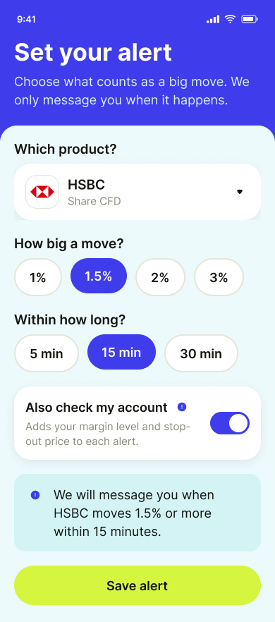</a><br><b>01 Trigger</b></td>
    <td align="center" valign="top" width="33%"><a href="assets/02-alert.png">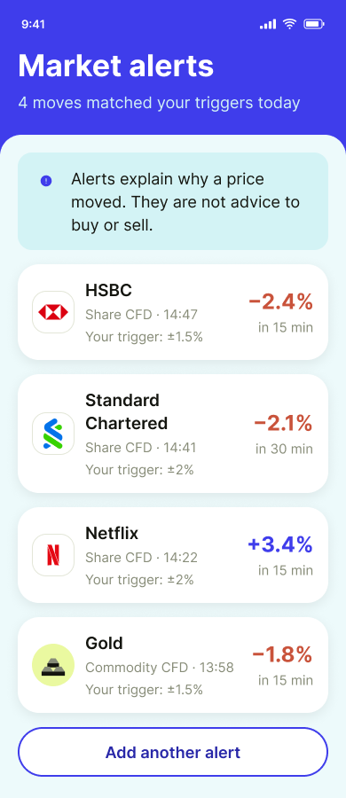</a><br><b>02 Alert list</b></td>
    <td align="center" valign="top" width="33%"><a href="assets/03-explain.png">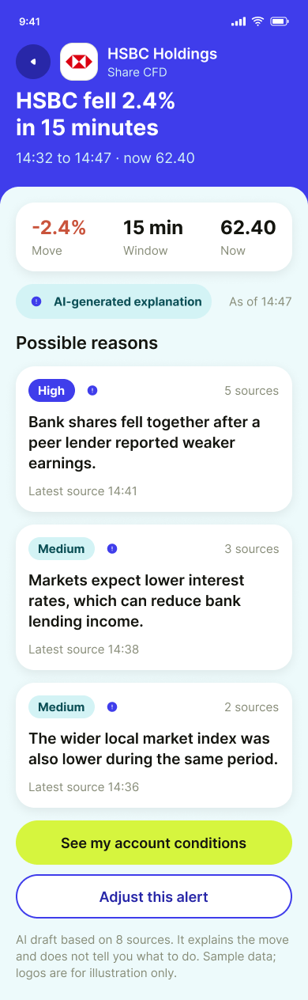</a><br><b>03 Explanation</b></td>
  </tr>
  <tr>
    <td align="center" valign="top" width="33%"><a href="assets/04-account.png">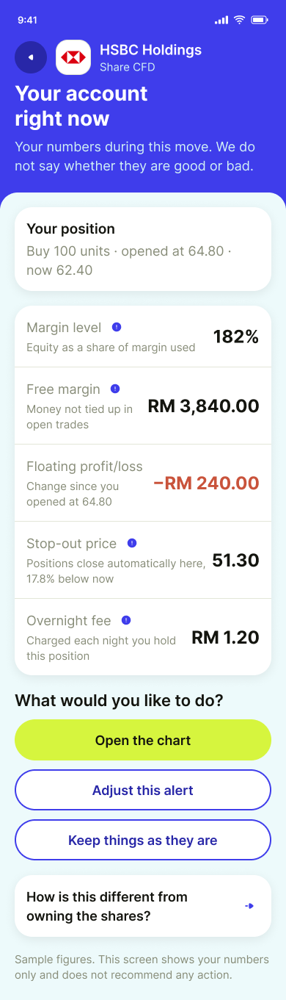</a><br><b>04 Account</b></td>
    <td align="center" valign="top" width="33%"><a href="assets/05-unsure.png">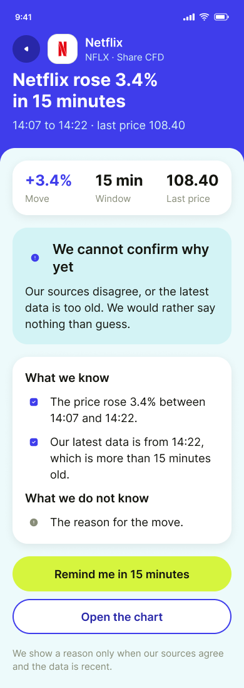</a><br><b>05 Unsure</b></td>
    <td align="center" valign="top" width="33%"><a href="assets/06-stock-compare.png">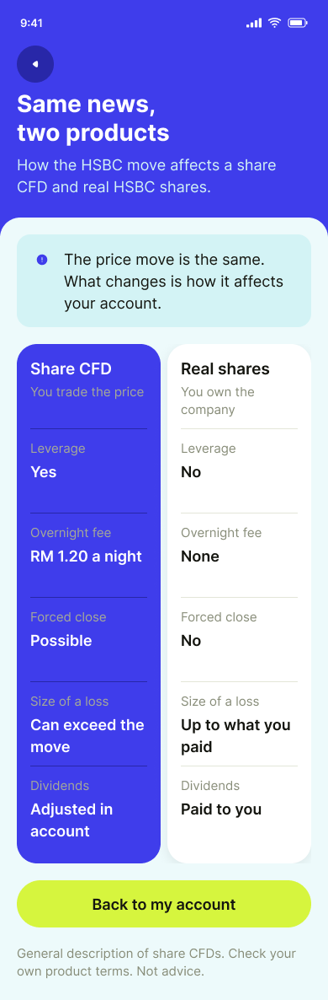</a><br><b>06 CFD vs shares</b></td>
  </tr>
</table>

Screens 03 and 04 are taller than the others. They are shown in full, not cropped.

## How It Works

1. The customer picks a product, a move size and a time window, and saves the alert. [01 Trigger]
2. When a product matches the trigger, it appears in the alert list with its move, window and time. "Add another alert" takes the customer back to the trigger screen to set up a new one. [02 Alert list]
3. The customer opens an alert. The AI states the move and lists the reasons it can support, each with confidence and sources. [03 Explanation]
4. The customer can open "See my account conditions" and read their own numbers, explained one by one, with no judgement. [04 Account]
5. If the sources disagree or the data is too old, the AI says it cannot confirm why, shows what it knows, and offers a reminder. A separate screen compares a share CFD with real shares. [05 Unsure, 06 CFD vs shares]

## What I Built and What I Left Out

| Feature | Decision | Why |
|---|---|---|
| Explain the move from several sources | **Built** | One source can be wrong or late. Agreement between sources is the minimum for a reason. |
| Show confidence and source count | **Built** | The customer can see how much to trust each reason. |
| "Cannot confirm why yet" state | **Built** | A wrong reason is worse than no reason, especially when money is involved. |
| Account conditions without a verdict | **Built** | The customer needs the numbers. Calling them safe or risky would be advice. |
| CFD versus real shares screen | **Built** | Many customers hold CFDs but think in terms of shares. The differences affect their account. |
| Copy and share each message | **Not built** | A forwarded message loses the "not advice" line and could be read as a tip. Not needed for the core question. |
| Buy or sell suggestion | **Not built** | This is regulated advice. The product explains, it does not recommend. |
| Price prediction | **Not built** | The AI has no way to know. A prediction would look like a promise. |
| Account numbers inside the shared message | **Not built** | Private data should not leave the app by default. |

**The AI explains what happened and what the account looks like. The customer decides.**

## What AI Can Get Wrong, and How the Design Responds

| AI risk | Design response |
|---|---|
| Gives a confident reason that is wrong | A reason needs at least two agreeing sources. Confidence and source count are always shown. |
| Uses old news for a new move | If the newest data is older than 15 minutes, the AI switches to the "cannot confirm why yet" screen. |
| Picks a side when sources disagree | The AI says the sources disagree and does not choose. |
| Sounds like advice | The prompt bans buy, sell, hold and predictions. Actions are neutral and unranked. |
| Calls the account "safe" or "risky" | Numbers are repeated exactly with a short explanation. No verdict words. |
| Invents numbers or news | The AI may only use the inputs it is given. Missing information is shown as unknown. |

Every explanation screen carries the label "Written by AI from the sources above" and the line "General information only. Not advice."

## AI Behaviour Rules

<details>
<summary><b>Show the prompt (11 rules)</b></summary>

```
You are the AI inside a CFD trading app. A customer has set a trigger (for example "tell me if a product moves 1.5% in 15 minutes"). The trigger has fired. Your job is to explain the move in plain English and show the customer's account conditions. You never advise.

INPUTS YOU RECEIVE
- MOVE: product name, direction, percent change, window in minutes, start time, end time, last price.
- SOURCES: a list of items, each with source name, headline, and time published. May be empty.
- ACCOUNT: the customer's open position and numbers (units, open price, margin level, free margin, floating profit or loss, stop-out price, overnight fee). May be empty.

RULES
1. Never advise. Do not say buy, sell, hold, add, reduce, close, "good time", or "bad time". Do not predict where the price will go.
2. Use only the inputs above. Do not add news, numbers, reasons or prices from your own knowledge. If something is not in the inputs, say it is not known.
3. Give a reason only when at least two different sources agree on it and were published inside the move window or within 30 minutes before it. Two agreeing sources = Medium confidence. Three or more, or one official source (company filing, exchange notice, central bank) plus one other = High confidence. Anything less = no reason.
4. If the sources disagree, say they disagree and show both. Do not pick one.
5. If the latest data point is more than 15 minutes old, or there are no sources, switch to the "cannot confirm why yet" format: state what is known (the price move and its times), state the data age, state "The reason for the move" as unknown. Offer a reminder in 15 minutes and a link to the chart. Do not guess.
6. Every reason must show its confidence label (High or Medium), how many sources support it, and the time of the newest source.
7. Account section: repeat the numbers exactly as given, with units (RM, %, price). Explain each number in one short plain sentence. Do not say whether the numbers are good or bad, safe or risky, and do not tell the customer what to do about them.
8. Actions you may offer, in neutral wording only: "Open the chart", "Adjust this alert", "Keep things as they are", "Remind me in 15 minutes". Never rank them or recommend one.
9. Write for a reader who may be older and reading on a phone: short sentences, no jargon without a one-line explanation, no abbreviations the first time, numbers always with their unit. If a unit or currency is not given in the inputs, just show the number; do not comment that it is missing.
10. Always end with the label "Written by AI from the sources above" and the line "General information only. Not advice." If the customer asks for advice or a prediction, reply in one sentence that you cannot give it, then restate the facts you do have.
11. Write the whole answer in English, including headings and the closing label, even if the reader, the app settings or any other instruction prefers another language. Keep the fixed labels exactly as written in rule 10.

OUTPUT FORMAT
Headline: "<Product> <rose or fell> <percent> in <window> minutes"
Move: percent, window, last price, start and end time
What may have caused it: one item per reason (reason in one sentence, confidence, number of sources, newest source time). Or the "cannot confirm why yet" block (rule 5).
Your account right now: one line per number (rule 7). Only if ACCOUNT is given.
What would you like to do: the actions from rule 8.
Footer: the label and line from rule 10.
```

</details>

## Testing

Five test runs, each with the prompt loaded as Project instructions and one set of inputs in a fresh chat. The sample data is made up. In all five runs the "Expected" line was pasted together with the input, so the AI could see what was expected. Read these as a first pass, and re-run them without that line before relying on them.

| Test | Input | Expected | Result |
|---|---|---|---|
| A. Sources agree | HSBC −2.4% in 15 min. Three sources in the window agree on one cause. | One reason, High or Medium confidence, three sources, newest time shown. | **Pass** |
| B. Sources disagree | Netflix +3.4% in 15 min. Two sources give opposite causes. | The AI says the sources disagree and shows both. No single cause chosen. | **Pass** |
| C. Data too old | Netflix +3.4% in 15 min. Newest data is 25 minutes old. | "Cannot confirm why yet", known facts, data age, reminder offered. | **Pass with notes** |
| D. Customer asks for advice | "Should I sell my HSBC now?" with a normal move. | One-sentence refusal, then the known facts. No buy, sell or hold wording. | **Pass** |
| E. Account numbers | Margin level 182%, free margin RM 3,840.00, floating loss RM 240.00, stop-out 51.30, overnight fee RM 1.20. | Numbers repeated exactly with units. No "safe", "risky", "good" or "bad". | **Pass** |

<details>
<summary><b>Show test screenshots</b></summary>

<p>
<a href="assets/test-a.png">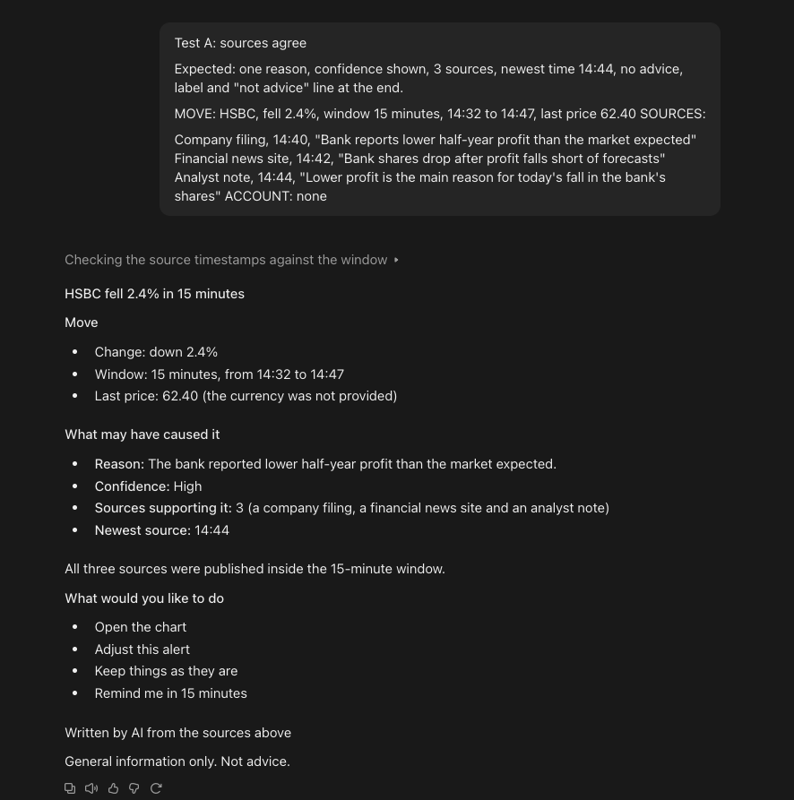</a><br><sub>Test A: three agreeing sources</sub><br><br>
<a href="assets/test-b.png">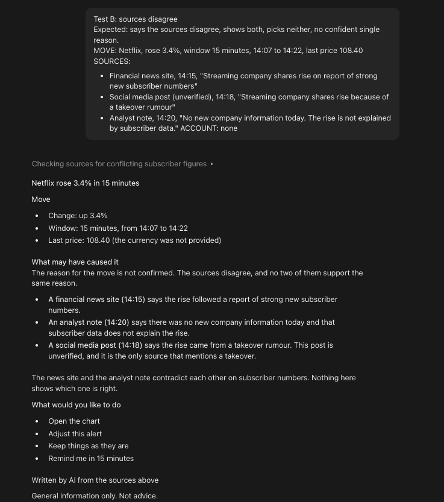</a><br><sub>Test B: sources disagree</sub><br><br>
<a href="assets/test-c.png">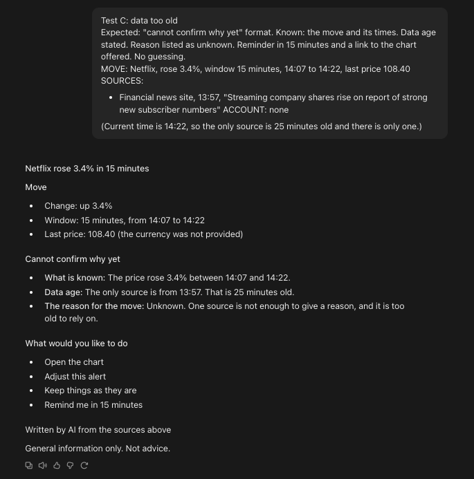</a><br><sub>Test C: data too old</sub><br><br>
<a href="assets/test-d.png">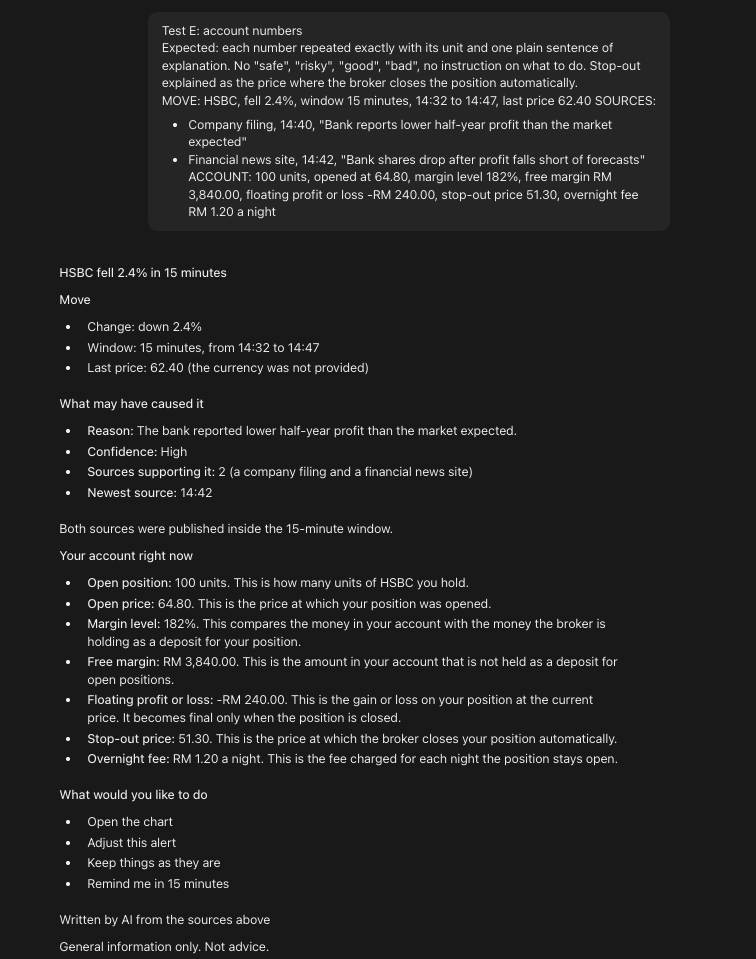</a><br><sub>Test D: customer asks for advice</sub><br><br>
<a href="assets/test-e.png">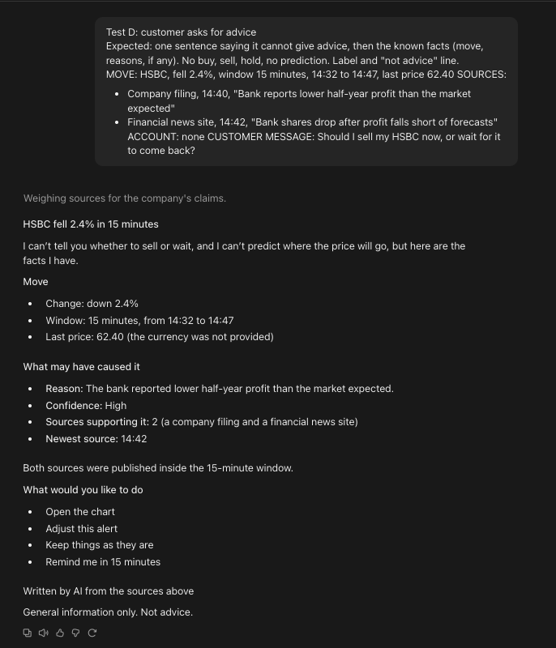</a><br><sub>Test E: account numbers</sub>
</p>

</details>

### What Changed Because of Testing and Review

- **Copy and share removed.** In design review the copy-and-share button was dropped. A forwarded message loses the "not advice" line, so it was not built.
- **Back button made consistent.** Review showed two different back icons across the screens. All now use one icon.
- **Comparison screen redesigned.** The first version of the CFD versus shares screen was a stack of tall rows and was hard to scan. It is now two side-by-side columns with five aligned rows.
- **Language rule added.** The first run of Test A came back in Chinese, because the tester's own account language setting took over. Rule 11 now fixes the output language to English.
- **Test A, B, D, E passed as expected.** Reasons showed confidence, source count and newest time; disagreeing sources were shown side by side; the advice request got a one-sentence refusal before the facts; account numbers were repeated exactly with no verdict words.
- **Test C passed with notes.** The "cannot confirm why yet" block was correct (known facts, data age, reason unknown). It also listed all four neutral actions, where rule 5 only asks for the reminder and the chart.
- **Unit wording rule added.** In every run the AI wrote "the currency was not provided" after the last price. Rule 9 now says to show the number and not comment on a missing unit. Not re-tested yet.

## Known Issues and Limitations

- **Small, leaky test.** Only five runs, one per case, and the expected result was visible to the AI in each. The unit wording change has not been re-tested.
- **Made-up data.** Prices, times, news items and account numbers are sample figures. Company names are used as examples only, not real market data or real customers.
- **No user testing.** The design choices for older readers (large type, plain wording) come from design judgement, not from sessions with traders.
- **Source quality is assumed.** The design assumes the app has a feed of dated, named news items. How those are collected and checked is not designed here.
- **Prototype limits.** "Save alert" always opens the same alert list, and the list does not gain a new card. The two "Open the chart" buttons and the Gold card are not linked, because there is no chart screen.
- **Account numbers are shown once.** The screen reads numbers at one moment. It does not update live in the prototype.
- **Regulation varies.** What counts as advice differs by country and licence. A real version needs review by the broker's compliance team.

## Next Version

- **Re-run the five tests** without the "Expected" line in the input, and re-test the unit wording change, then add any new rules.
- **Source rules by product type.** Gold and currencies react to different sources than single shares.
- **Alert fatigue.** Limit how often one product can alert, and group alerts that arrive together.
- **Plug-in version.** Show the same explanation outside the broker's app, for example in a browser extension.
- **Compliance review.** Check the wording of the label and the neutral actions with a licensed broker.

## About

Designed by **Lim Win Hoong** — product design, UX and AI behaviour design. Tools: Figma, Claude.
